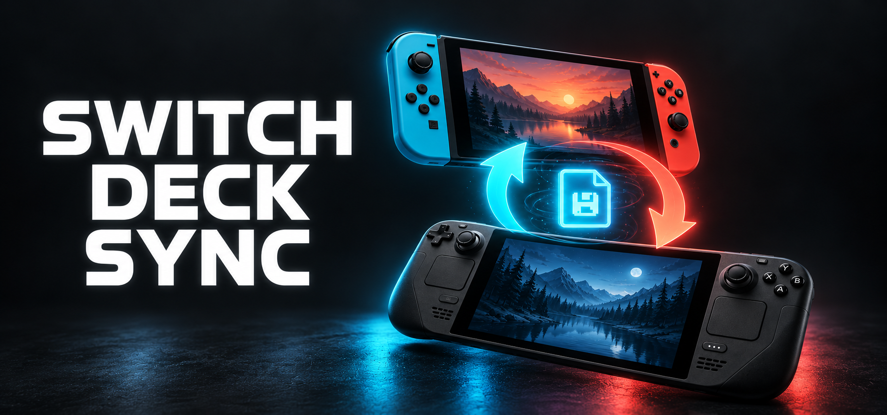

# Switch Deck Sync

Sync saves between Nintendo Switch and Ryujinx over Wi-Fi on Steam Deck,
Steam Machine or another Linux computer. Use your existing emulator setup;
EmuDeck and a separate memory card are optional.

**Preview 0.5.0 · English and Russian**

[Installation guide](docs/INSTALL.md) · [Инструкция на русском](docs/INSTALL.ru.md)
· [Switch setup](docs/SWITCH.md) · [Roadmap](ROADMAP.md)

## Get started

Download these files from the newest preview's **Assets** on the
[Releases page](../../releases):

| Device | Download | Next step |
| --- | --- | --- |
| Steam Deck / Linux | **Switch-Deck-Sync-0.5.0-preview.zip** | Extract the whole ZIP and open **Install.desktop** in Desktop Mode. |
| Nintendo Switch | **ftpsrv-save-sync.nro** | Copy to `/switch/` on the Switch SD card and follow [Switch setup](docs/SWITCH.md). |

The Switch companion is also included in the installer's **switch/** folder.
Use the named installer ZIP; GitHub's **Source code** archives are for development.

1. Close games and Ryujinx. Run the installer and choose **Sync saves with Switch**.
2. Open **Switch Deck Sync** from Steam or the application menu.
3. In **Settings**, enter the address shown by **ftpsrv Save Sync**, then choose
   your Switch profile, Ryujinx profile and games.
4. With games closed on both devices, keep ftpsrv open and press **Sync saves**.

The installer language is used by the app. Change it later under
**Settings → Language**. This preference stays on the computer.

## What happens to your saves

If one side changed since the last sync, the complete save is copied to the other
side. If both changed, or different saves have no shared sync history yet, you
choose which progress to keep. File dates do not decide the winner.

Both versions are backed up before replacement. Written saves are read back and
checked. If a transfer is interrupted, leave ftpsrv open and run sync again to
recover before starting that game on Switch.

Each game needs an existing **account save** in Ryujinx before its first import:
start it once and create a save. Use compatible game versions on both devices.
BCAT, system/device saves and conversion between game save formats are outside
this preview.

## Optional: take saves between SteamOS devices

Choose **Portable library on a memory card** to use the same card's saves on
several SteamOS computers. Install this option once on each computer. It requires
native Ryujinx installed through EmuDeck, an ext4 card and a selected card reader.

The card carries games, Ryujinx profile/data and sync history. Graphics/controller
settings and shader caches stay on each computer. Close games and sync, safely
eject the card, and move it to the other device. See the
[portable setup steps](docs/INSTALL.md#optional-portable-card).

Choose game entries and artwork in **Steam ROM Manager** on each device.

## Supported setup

- Linux with KDE, Python 3.10+, kdialog, SDL2, SDL2_ttf and DejaVu Sans.
- Existing Ryujinx account saves; Steam integration when a Steam profile exists.
- **ftpsrv Save Sync** on a homebrew-enabled Switch, on the same reachable local
  network. FTP is anonymous and unencrypted; run the server only while transferring
  on a trusted network.
- Optional card setup additionally requires native EmuDeck Ryujinx, ext4, systemd
  user services, lsblk and udisksctl. See the guide for the supported card layout.

Use your own games, keys and firmware. They are not distributed with this project.
Windows/macOS clients, DBI and other emulator save layouts are not supported yet.

## Update, restore and help

Extract a newer installer ZIP and run **Install.desktop → Update save sync**.
It keeps the current storage mode and sync configuration. Open Steam from the
application menu after setup.

The installer also offers **Restore the previous settings**. Installer backups
are under `~/.local/share/switch-deck-sync/backups/`; sync backups and results are
stored with the selected library's sync data. See the
[installation guide](docs/INSTALL.md#backups-and-restore).

For a problem report, include your OS, emulator/app versions and the displayed
error. Do not upload keys, games, personal saves or whole configuration archives.

## Development and licence

[Architecture](docs/ARCHITECTURE.md) · [Hardware validation](docs/STEAM-MACHINE-TEST.md)
· [Contributing](CONTRIBUTING.md) · [Changes](CHANGELOG.md)

Run tests on Linux: `PYTHONPATH=app python3 -m unittest discover -s tests -v`.
The SDL smoke test uses Xvfb in CI. Build releases with
`python3 scripts/build_release.py`.

Client/installer: [MIT](LICENSE). The Switch companion derives from
[ITotalJustice/ftpsrv](https://github.com/ITotalJustice/ftpsrv), with its own MIT
notices, patch and complete source in **switch/** and release Assets.
This is an independent, unofficial project.
